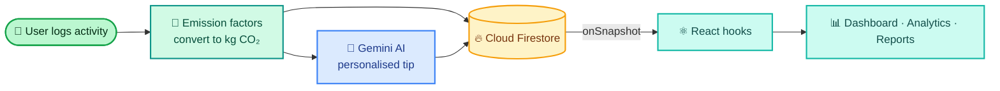

<p align="center">
  
</p>

<p align="center">
  
</p>

<p align="center">
  
  
  
  
  
  
  
</p>

<p align="center">
  <a href="#-about"></a>
  <a href="#-features"></a>
  <a href="#-how-it-works"></a>
  <a href="#-emission-factors"></a>
  <a href="#-tech-stack"></a>
  <a href="#-getting-started"></a>
  <a href="#-developer"></a>
</p>


## 🌿 About

**EcoTrack AI** is a personal carbon footprint tracker that updates in real time. Log a trip, a meal or your appliance usage, and the app converts it into CO₂ using real emission factors, measures it against your daily target and gives you a personalised tip from Gemini AI.

Built as an academic mini project (**24PMIP301**) at M.O.P. Vaishnav College for Women.

> [!TIP]
> The Earth globe, the Qbit mascot and every progress ring in the app follow the same three states below.

<table align="center">
  <tr>
    <td align="center" width="200">🟢<br><b>Under target</b><br><sub>You're on track</sub></td>
    <td align="center" width="200">🟡<br><b>Close to target</b><br><sub>Watch your habits</sub></td>
    <td align="center" width="200">🔴<br><b>Over target</b><br><sub>Time to cut back</sub></td>
  </tr>
</table>


## ✨ Features

<table>
  <tr>
    <td width="50%" valign="top">


- 🚗 **Travel:** car, scooty, bus, train, plane, bike
- 🍽️ **Food:** beef, chicken, fish, vegetarian, vegan, coffee
- ⚡ **Electricity:** fan, AC, fridge, TV, geyser and more
- 🌍 **Live score:** realtime daily total with a spinning Earth

   </td>
   <td width="50%" valign="top">


- 🤖 **Gemini eco tips** after every logged activity
- 📈 **30-day trend** and emission-source breakdown
- 🗓️ **Carbon heatmap** and monthly goal
- 🏅 **Achievements** earned from your real data

   </td>
  </tr>
  <tr>
    <td width="50%" valign="top">


- 📊 Monthly breakdown and month-over-month comparison
- 📄 Export as **PDF** or **CSV**
- 📤 Web Share, copy summary and print

   </td>
   <td width="50%" valign="top">


- 🏙️ **Carbon City Builder** and 🎯 **Eco Catch** games
- 🤖 **Qbit**, a colour-reactive 3D robot mascot
- ⌘ **Command palette** (`Ctrl+K` / `⌘K`)
- ⚙️ **Preferences:** daily target, unit, display name

   </td>
  </tr>
</table>


## 🔄 How It Works



Every number on screen is read live from Firestore through realtime hooks, so a new log updates the score, charts and reports instantly.


## 🧮 Emission Factors

<p align="center">
  
  
  
</p>

<table>
  <tr>
    <th>🚗 Travel <sub>(kg CO₂ / km)</sub></th>
    <th>🍽️ Food <sub>(kg CO₂ / serving)</sub></th>
    <th>⚡ Electricity</th>
  </tr>
  <tr>
    <td valign="top">

<br>
<br>
<br>
<br>
<br>


   </td>
   <td valign="top">

<br>
<br>
<br>
<br>
<br>


   </td>
   <td valign="top" align="center">
<br><br>
<b>0.82</b><br>
kg CO₂ / kWh<br>
<sub>TNEB grid</sub>
   </td>
  </tr>
</table>


## 🛠️ Tech Stack

| Layer | Technologies |
|---|---|
| 🎨 **Frontend** | React · TypeScript · Vite · Tailwind CSS · shadcn/ui · Recharts · Framer Motion |
| 🔥 **Backend & Data** | Firebase Authentication · Cloud Firestore · Firebase Hosting |
| 🤖 **AI** | Google Gemini (`@google/genai`) |
| 🧪 **Testing** | Jest · React Testing Library |
| 🖌️ **Design** | Figma |


## 🗂️ Data Model

```text
users/{uid}                 → displayName, city, vehicleType, dietType, unit, dailyTarget
 ├─ actions/{id}            → category, subType, value, carbonKg, geminiTip, loggedAt
 └─ dailyScores/{date}      → travelCarbon, foodCarbon, electricityCarbon, totalCarbon, tipCount
```


## 🚀 Getting Started

**1. Clone and install**

```bash
git clone https://github.com/Subhashini-Anbalagan/EcoTrack-AI.git
cd EcoTrack-AI
npm install
```

**2. Add your keys**

<details>
<summary>📄 Create a <code>.env.local</code> file in the project root</summary>

```env
VITE_FIREBASE_API_KEY=your_key
VITE_FIREBASE_AUTH_DOMAIN=your_domain
VITE_FIREBASE_PROJECT_ID=your_project_id
VITE_FIREBASE_STORAGE_BUCKET=your_bucket
VITE_FIREBASE_MESSAGING_SENDER_ID=your_id
VITE_FIREBASE_APP_ID=your_app_id
VITE_GEMINI_API_KEY=your_gemini_key
```

</details>

> [!IMPORTANT]
> Never commit `.env.local`. It is already listed in `.gitignore`.

**3. Run**

```bash
npm run dev
```

**4. Test**

```bash
npm test
```


## 🧪 Quality

<p>
  
  
  
</p>


## 👩‍💻 Developer

<table>
  <tr>
    <td>
      <b>A. Subhashini</b><br>
      🎓 M.Sc. Information Technology<br>
      🔗 <a href="https://github.com/Subhashini-Anbalagan">GitHub</a>
    </td>
  </tr>
</table>

<p align="center">
  <b>⭐ If EcoTrack AI inspired you to cut a little carbon, give it a star! 🌱</b>
</p>


